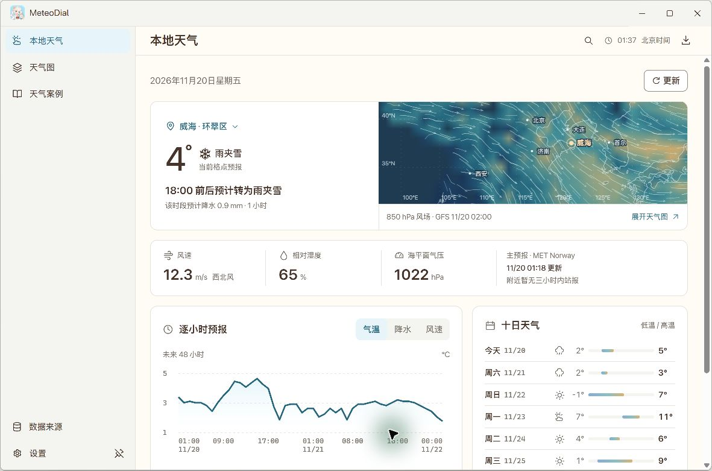

<p align="center"></p>

<h1 align="center">MeteoDial</h1>
<p align="center">English | <a href="./README.zh-CN.md">简体中文</a></p>

MeteoDial (观象) is a Windows weather app by Cinna. Look up a city or county in China to see when the temperature, wind or precipitation is forecast to change. Open a second map alongside the first to see how the weather system develops.

[Download for Windows x64](https://github.com/icelemon233/MeteoDial/releases/latest) · [Run from source](#run-from-source)



## Using MeteoDial

Press **Ctrl K** to search 3,641 cities, counties and districts by name or pinyin. **使用我的位置** (Use my location) finds the nearest national station in the bundled directory. Select the station to see each measurement and its observation time. The local forecast covers the next 48 hours by hour and the next 10 days by day.

**天气图** (Weather maps) opens with a 16:9 map of China. Switch to two or four panels to compare upper-air patterns, lower-level transport and near-surface wind at the same valid time. The timeline loops automatically. Drag it to pause on a particular frame. If a GFS field or the selected grid point is missing, the app checks ECMWF IFS and the NOAA GEFS control forecast at the same level, initialization and valid time. Each panel identifies its field and source. Gray cells mark a pressure surface at or below model terrain.

**天气案例** (Case studies) includes 13 offline map replays, including a Beijing snowfall, the 2008 southern China ice storms, the January 2016 cold wave and the July 2021 Henan floods. Open **重大气象灾害档案** to search event analyses since 2001 by year, place or hazard. Each entry links to its source. [View the Bohai snow case](./docs/previews/bohai-snow.png)

## Run from source

The interface is in Simplified Chinese. The desktop installer includes Electron and targets Windows x64, starting with Windows 10 build 19041. For development, install Node.js 24 or later and run the following commands in the project directory.

```sh
npm ci
npm start
```

`npm test` runs the tests. `npm run service` starts the local web app at `http://127.0.0.1:4173`. `npm run package` builds the Cinna Windows installer with Inno Setup 7.1.0 and Zig 0.15.2. Optional service and build settings are documented in the [development notes](./docs/development.md).

The main forecast comes from MET Norway. The maps use NOAA GFS, Himawari satellite observations, regional radar from CWA and tropical cyclone tracks from the Hong Kong Observatory. The case studies also include NASA satellite composites and historical records. [Data sources and attribution](./assets/NOTICE.txt)
