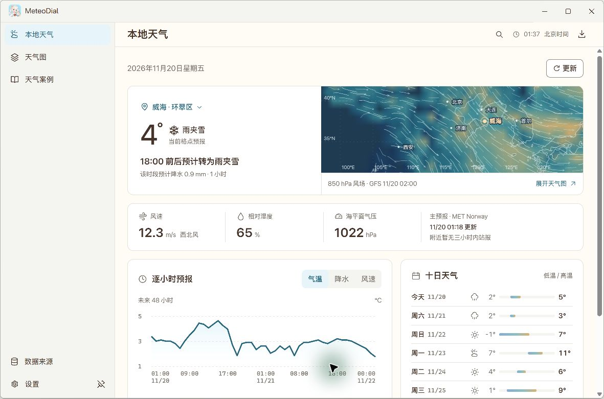

<p align="center"></p>

<h1 align="center">MeteoDial · 观象</h1>
<p align="center"><a href="./README.md">English</a> | 简体中文</p>

观象是 Cinna 开发的 Windows 天气应用。选一个城市或区县，先看气温、风和降水预计从什么时候开始变化，再打开同一时段的天气图，跟着天气系统一起看。

[下载 Windows x64 安装包](https://github.com/icelemon233/MeteoDial/releases/latest) · [从源码运行](#从源码运行)



## 使用观象

按 **Ctrl K**，可以用地名或拼音搜索 3,641 个市、县及分区地点，也可以选「使用我的位置」，在本机匹配站表中最近的国家站。点击站名可查看各要素的实测值和观测时间。本地预报提供未来 48 小时的逐小时变化和 10 天的逐日趋势。

**天气图** 默认显示一张 16:9 全国图。切到双图或四图，可以并排看同一时次的高空形势、冷暖输送和近地风。播放会循环推进，拖动时间轴可停在指定时刻。点击地图换选点，或手动固定气压层。GFS 缺少图层或选点数值时，应用会查询同一起报、同一时效的 ECMWF IFS 和 NOAA GEFS 控制预报。图下标出实际层次和来源，灰色表示气压面位于模式地面或地下。

**天气案例** 内置 12 组全国天气过程回放和一组全球气压带季节对照，均可离线查看。案例涵盖北京初雪、2008 年南方雨雪冰冻、2016 年寒潮和 2021 年河南暴雨。「重大气象灾害档案」可按年份、地区关键词和灾种查阅 2001 年以来的过程分析，各条均可追溯至原始资料。[查看冷流雪案例](./docs/previews/bohai-snow.png)

## 从源码运行

桌面界面使用简体中文。安装包自带 Electron，支持 Windows 10 build 19041 及以上的 x64 系统。开发时需要 Node.js 24 或更新版本，在项目目录执行以下命令。

```sh
npm ci
npm start
```

`npm test` 运行测试。`npm run service` 启动本地 Web 应用，默认地址是 `http://127.0.0.1:4173`。`npm run package` 使用 Inno Setup 7.1.0 和 Zig 0.15.2 构建 Cinna 系列安装包。可选的服务与打包配置见[开发说明](./docs/development.md)。

区县主预报来自 MET Norway。天气图采用 NOAA GFS 模式、葵花卫星观测、CWA 区域雷达和香港天文台的热带气旋路径。归档案例还收录了 NASA 卫星日合成和机构实况记录。[资料来源与署名](./assets/NOTICE.txt)
